*This project has been created as part of the 42 curriculum by &lt;hugo-login&gt;, &lt;miguel-login&gt;, &lt;pedro-login&gt;, &lt;rafael-login&gt;, &lt;duarte-login&gt;.*

<!-- TODO(team): replace the placeholders above with the five 42 logins. -->

# Transcendence

## Description

**Transcendence** is a real-time crypto price prediction game. Players bet virtual
money (**T$**) on whether the price of **Bitcoin** or **Ethereum** will be **UP** or
**DOWN** after **1 or 5 minutes**. Prices come live from the Kraken exchange, bets are
settled by the server, and every result feeds a leaderboard, an achievement system
and a personal analytics dashboard. It feels like a sports-betting site, with a
single game and no real money.

The goal of the project is to build a complete, secure, multi-user web application
(frontend, backend, database) deployed with one command, and to go further with
modules in web, user management, security, DevOps, data and gamification.

### Key features

- **Live trading game**: BTC/EUR and ETH/EUR prices streamed from Kraken, live
  candlestick chart (1m / 5m / 15m, volume, entry prices of your bets), UP/DOWN bets
  with 1 or 5 minute expiry, 1.85× payout, server-side settlement.
- **Multi-user in real time** (Socket.IO): prices, your bet results, a live feed of
  everyone's bets, online players and leaderboard updates are pushed to every browser.
- **Accounts**: registration and login with email + password (bcrypt), JWT sessions,
  profile with avatar (default avatar generated), password change, account deletion.
- **Friends**: friend requests, friends list with live online status, public profiles.
- **Gamification**: XP and levels, 12 achievements, win streaks, daily bonus,
  public leaderboard and player profiles.
- **Analytics dashboard**: interactive charts (line, bar, donut), live updates,
  date/coin/duration/direction filters, CSV / JSON / PDF export; platform statistics
  for administrators.
- **Roles**: guest, user, moderator and admin, each with different pages and actions
  (admin user management, moderation queue).
- **Forum** with automatic moderation, reports and advanced search.
- **Public Admin API** secured with an API key, rate limited, documented with Swagger.
- **Security & operations**: HTTPS everywhere, ModSecurity WAF (OWASP CRS), HashiCorp
  Vault for secrets, ELK log management, Prometheus + Grafana monitoring, health checks,
  status page and automated database backups.
- **Privacy Policy** and **Terms of Service** pages, linked from the footer.

## Instructions

### Prerequisites

| Tool | Version | Notes |
|------|---------|-------|
| Docker Engine | 24 or later | rootful or rootless |
| Docker Compose | v2 (`docker compose`) | plugin of Docker |
| GNU make | any | runs the whole setup |
| openssl | any | or `mkcert` for certificates trusted by the browser |
| Google Chrome | latest stable | the supported browser |

The full stack (including Elasticsearch, Logstash and Kibana) needs about **6 GB of RAM**
and the first build downloads about 3 GB of images.

### Run

```bash
git clone <repository-url> transcendence
cd transcendence
make
```

`make` does everything:

1. creates `.env` from `.env.example` with random secrets if it does not exist
   (`scripts/setup-env.sh`) — to choose your own values, copy `.env.example` to `.env`
   and edit it before running `make`;
2. creates the TLS certificates (`scripts/setup-certs.sh`, with `mkcert` if installed,
   otherwise a local CA made with `openssl`, no `sudo` needed);
3. builds the images and starts all the containers;
4. waits until the site is ready and prints the URL and the admin login.

Then open **https://localhost** (on rootless Docker, `make` uses **https://localhost:8443**;
you can force ports with `HTTPS_PORT` / `HTTP_PORT` in `.env`). Without `mkcert` the
browser shows a certificate warning the first time: choose *Advanced → Proceed*, or import
`vault/certs/ca.pem` as a trusted authority.

The admin account (email and password) is printed by `make` and stored in `.env`
(`ADMIN_EMAIL`, `ADMIN_PASSWORD`). New players can register from the website and get
1,000 T$.

### Useful commands

| Command | Effect |
|---------|--------|
| `make` | set up, build and start everything |
| `make ps` | container status |
| `make logs SERVICE=backend` | follow the logs of one service |
| `make down` | stop and remove the containers (data is kept) |
| `make clean` | `down` + remove build output |
| `make fclean` | remove this project's containers, images, volumes and certificates |
| `make re` | `fclean` + `make` |

After a reboot, run `make` again: Vault restarts sealed, `vault_init` unseals it
and the backend, which waits for Vault, resumes on its own. Data is kept.

### Other URLs

| URL | What | Access |
|-----|------|--------|
| `/status/` | system status page | public |
| `/grafana/` | monitoring dashboards | `GF_SECURITY_ADMIN_USER` / `GF_SECURITY_ADMIN_PASSWORD` |
| `/prometheus/` | metrics and alert rules | through nginx |
| `/kibana/` | logs | `elastic` / `ELASTIC_PASSWORD` |
| `/api/admin/docs` | Swagger of the Public Admin API | header `X-API-Key: <ADMIN_API_KEY>` |

### Environment variables

`.env.example` lists every variable. The secrets are written to Vault at start-up
(`vault/config/vault-init.sh`) and the backend reads them from Vault with an AppRole.

## Team Information

<!-- TODO(team): confirm the roles below; they were not written down anywhere in the repository. -->

| Member | GitHub | Role(s) | Responsibilities |
|--------|--------|---------|------------------|
| Hugo Dias | `hugo-mar` | Project Manager, Developer | Organised the meetings and the plan; forum, moderation and Public API |
| Rafael Matos | `1Fr3aK2` | Technical Lead / Architect, Developer | Docker architecture, security (WAF, Vault, TLS), DevOps (ELK, Prometheus, Grafana, backups) |
| Pedro | `SuVao` | Developer (backend) | NestJS core: users, authentication, roles, friendship model, Kraken price feed, health checks |
| Duarte Araujo | `dsteiger42` | Product Owner, Developer (frontend) | Product vision and priorities; React interface, trading UI, forum and account pages |
| Miguel Dias | `migueldias2` | Developer (trading engine) | Server-side betting engine, real-time events, friends, gamification, analytics dashboard, admin/moderation UI, legal pages |

## Project Management

- **Organisation**: the project idea and the division of work were decided in in-person
  meetings at school (the first one on 9 June); each member owned one area (frontend,
  backend, trading engine, forum/moderation, infrastructure/security/DevOps) and
  integrated through pull requests.
- **Workflow**: one branch per feature or member, pull requests into `dev`, merged
  after review; `dev` is the integration branch.
- **Tools**: GitHub (repository, branches, pull requests), a shared plan made at the
  first meeting, and documentation kept in the repository (`docs/`, module READMEs).
- **Communication**: a team group chat for daily coordination, plus regular meetings
  at school.

## Technical Stack

| Layer | Technology | Why |
|-------|------------|-----|
| Frontend | React 18, React Router 7, Vite 5 | component model, large ecosystem, fast builds |
| Styling | Tailwind CSS 4 + the original CSS (in a lower cascade layer) | utility classes and design tokens without rewriting the existing design |
| Charts | Recharts; TradingView Lightweight Charts | declarative React charts; real candlestick chart with live updates |
| Real time | Socket.IO (server and client) | rooms, reconnection and fallbacks out of the box |
| Backend | NestJS 10 (Node.js 20, TypeScript) | modules, dependency injection, guards and validation pipes |
| Database | PostgreSQL 16 | relational data with constraints and transactions: wallet updates must be atomic |
| ORM | Prisma 6 | typed client, schema-first migrations |
| Cache / limits | Redis | login brute-force and API rate limiting counters |
| Market data | Kraken WebSocket API v2 (live), CoinGecko (history) | free, no API key |
| Reverse proxy / WAF | nginx + ModSecurity v3 + OWASP CRS 4 | HTTPS termination and request filtering |
| Secrets | HashiCorp Vault (AppRole) | secrets out of the code and of the containers' environment |
| Logs | Filebeat → Logstash → Elasticsearch → Kibana | centralised logs with 14-day retention (ILM) |
| Monitoring | Prometheus + exporters, Grafana | metrics, dashboards and alert rules |
| Deployment | Docker Compose + Makefile | one command on any machine |

**Why PostgreSQL**: money-like data (balances, stakes, payouts) needs transactions and
row locking. Placing a bet debits the wallet with a conditional `UPDATE` inside a
transaction, so two simultaneous bets can never spend the same T$.

## Database Schema

```mermaid
erDiagram
    User ||--o{ Bet : places
    User ||--o{ WalletTransaction : "wallet history"
    Bet ||--o{ WalletTransaction : "stake / payout / refund"
    User ||--o{ UserAchievement : unlocks
    Achievement ||--o{ UserAchievement : "unlocked by"
    User ||--o{ Post : writes
    User ||--o{ Comment : writes
    Post ||--o{ Comment : has
    User ||--o{ Report : "reports (reporter)"
    User |o--o{ Report : "resolves (moderator)"
    User |o--o{ ModerationLog : "acts (moderator)"
    User ||--o{ Friendship : "sends request"
    User ||--o{ Friendship : "receives request"

    User {
        int id PK
        string username UK
        string email UK
        string password "bcrypt hash"
        int wallet "T$ balance"
        string avatar "data URL, optional"
        enum role "USER | MODERATOR | ADMIN"
        int wins
        int losses
        int xp
        int currentStreak
        int bestStreak
        int dailyStreak
        datetime lastDailyClaimAt
    }
    Bet {
        int id PK
        int userId FK
        string coin "BTC | ETH"
        enum direction "UP | DOWN"
        int amount
        int duration "60 | 300 s"
        float entryPrice
        float exitPrice
        int payout
        enum status "PENDING | WON | LOST | REFUNDED"
        datetime expiresAt
        datetime resolvedAt
    }
    WalletTransaction {
        int id PK
        int userId FK
        int betId FK "optional"
        enum type "SIGNUP_BONUS | BET_STAKE | BET_PAYOUT | BET_REFUND | DAILY_BONUS | ADMIN_ADJUSTMENT"
        int amount "signed"
        int balanceAfter
    }
    Achievement {
        string code PK
        string name
        string description
        string icon
        int xpReward
    }
    UserAchievement {
        int userId PK
        string achievementCode PK
        datetime unlockedAt
    }
    Post {
        int id PK
        int authorId FK
        string title
        string content
        string status "visible | pending | removed"
        float moderationScore
    }
    Comment {
        int id PK
        int postId FK
        int authorId FK
        string content
        string status
    }
    Report {
        int id PK
        int reporterId FK
        int moderatorId FK "optional"
        string targetType "post | comment"
        int targetId
        string status "pending | resolved"
    }
    ModerationLog {
        int id PK
        int moderatorId FK "optional"
        string targetType
        int targetId
        string action
    }
    Friendship {
        int id PK
        int senderId FK
        int receiverId FK
        enum status "PENDING | ACCEPTED"
        datetime createdAt
    }
```



- Deleting a user cascades to their bets, wallet history, achievements, friendships,
  posts, comments and reports; moderation logs are kept without the moderator reference.
- `Friendship(senderId, receiverId)` is unique; accepting a request also removes a
  crossed request in the other direction, so two players have at most one row.
- Indexes: `Bet(userId, createdAt)` for history, `Bet(status, expiresAt)` for the
  settlement loop, `WalletTransaction(userId, createdAt)` for the balance chart.
- Invariant: for every user, the sum of `WalletTransaction.amount` equals `User.wallet`.
- Schema: `backend/prisma/schema.prisma`; migrations in `backend/prisma/migrations/`
  are applied automatically by the `backend_migrate` container.

## Features List

| Feature | Description | Member(s) |
|---------|-------------|-----------|
| Registration and login | Email + password, bcrypt, JWT; validation in the browser and in NestJS DTOs; 18+ and terms checkbox | Pedro, Duarte, Miguel |
| Profile and settings | Username, avatar (resized in the browser, default avatar generated), password change, account deletion | Pedro, Duarte, Miguel |
| Friends | Requests by username or from a profile, accept/decline/cancel, friends list with live online status | Pedro (design), Miguel |
| Live prices and chart | Kraken WebSocket feed, 24h stats, live candlestick chart (12 h of 1-minute candles, 1m/5m/15m, volume) and 10-minute line chart | Pedro, Duarte, Miguel |
| Betting engine | Bets placed, stored and settled on the server; atomic wallet debit; 1/5 min expiry; refunds | Miguel |
| Real-time events | Bet results, wallet, achievements, live feed, presence, leaderboard refresh over Socket.IO | Miguel, Pedro |
| Gamification | XP/levels, 12 achievements, streaks, daily bonus, rewards page | Miguel |
| Leaderboard and profiles | Ranking by balance, XP or wins; public player profiles | Miguel |
| Analytics dashboard | Charts, filters, live updates, CSV/JSON/PDF export, admin platform view | Miguel |
| Roles and admin | Guest/user/moderator/admin views, user CRUD, role changes, balance corrections | Pedro, Hugo, Miguel |
| Forum | Posts, comments, reports, search with filters, sorting and pagination | Hugo, Duarte |
| Automatic moderation | Scoring of forum text (scams, spam, abuse, links); reject or hold for review; moderation UI | Hugo, Miguel |
| Public Admin API | API key, rate limit, Swagger, 8 endpoints | Hugo |
| HTTPS, WAF and Vault | TLS everywhere, ModSecurity + OWASP CRS, secrets in Vault via AppRole | Rafael |
| Logs | ELK stack with Filebeat, 14-day retention (ILM), secured Kibana | Rafael |
| Monitoring | Prometheus, exporters, Grafana dashboards, alert rules, business metrics (bets) | Rafael, Miguel |
| Health and backups | `/health` endpoints, status page, daily PostgreSQL backups, restore procedure | Rafael |
| Legal pages | Privacy Policy and Terms of Service written for this application | Miguel |
| One-command deployment | `make` with generated `.env`, certificates without sudo, rootless Docker support | Rafael, Miguel |

## Modules

| # | Module | Type | Points | Member(s) |
|---|--------|------|--------|-----------|
| 1 | Web — Frontend and backend frameworks (React + NestJS) | Major | 2 | Duarte, Pedro |
| 2 | Web — Real-time features with WebSockets | Major | 2 | Pedro, Miguel |
| 3 | Web — Public API (API key, rate limiting, documentation, 8 endpoints) | Major | 2 | Hugo |
| 4 | User Management — Standard user management and authentication | Major | 2 | Pedro, Duarte, Miguel |
| 5 | User Management — Advanced permissions system | Major | 2 | Pedro, Hugo, Miguel |
| 6 | Cybersecurity — WAF/ModSecurity (hardened) + HashiCorp Vault | Major | 2 | Rafael |
| 7 | DevOps — Log management with ELK | Major | 2 | Rafael |
| 8 | DevOps — Monitoring with Prometheus and Grafana | Major | 2 | Rafael |
| 9 | Data and Analytics — Advanced analytics dashboard | Major | 2 | Miguel |
| 10 | Web — ORM (Prisma) | Minor | 1 | Pedro, Hugo, Miguel |
| 11 | Web — Advanced search with filters, sorting and pagination | Minor | 1 | Hugo, Duarte |
| 12 | Gaming and UX — Gamification system | Minor | 1 | Miguel |
| 13 | DevOps — Health check, status page, automated backups and disaster recovery | Minor | 1 | Rafael |
| | **Total** | | **22** | 9 majors × 2 + 4 minors × 1 (14 required, bonus capped at 5) |

### How each module is implemented and why we chose it

1. **Frameworks (React + NestJS)** — The interface is a React single-page app (React
   Router, context for shared state); the API is a NestJS application organised in
   modules (`users`, `auth`, `bets`, `gamification`, `analytics`, `forum`, ...), with
   guards for authentication/roles and `ValidationPipe` + class-validator DTOs for every
   input. Chosen for structure and to share TypeScript/JavaScript across the team.
2. **Real-time (Socket.IO)** — `backend/src/realtime/realtime.gateway.ts`. Prices are
   throttled to 2 updates per second per coin and broadcast, like the live 1-minute
   candles; new clients receive a snapshot with the last 10 minutes. Logged-in sockets authenticate with the JWT and
   join a private room (`user:<id>`) for bet results, wallet, achievements and role
   changes. Public events: live bets feed, online players, leaderboard changes. The
   client shows the connection state, reconnects automatically and resynchronises after
   a drop. Real time is the heart of a live trading game, which is why we chose it.
3. **Public API** — `backend/src/public-api`. `X-API-Key` guard (timing-safe compare,
   key stored in Vault), Redis rate limit (100 requests/min per IP) plus nginx limits,
   Swagger at `/api/admin/docs`, endpoints `GET /api/admin/users`, `PUT
   /api/admin/users/:id/role`, `GET /api/admin/reports`, `PATCH
   /api/admin/reports/:id/resolve`, `GET /api/admin/moderation/pending`, `GET
   /api/admin/moderation/logs`, `POST /api/admin/posts`, `DELETE /api/admin/posts/:id`.
   Test script: `scripts/test-public-api.sh`.
4. **Standard user management** — Users update their username and avatar in Settings
   (the image is cropped and resized in the browser and validated again by the API);
   without an upload, a default avatar is generated (`GET /users/:id/avatar`). Friends:
   requests by username or from a profile (`/api/friends`), accept, decline, cancel and
   remove, and a friends list with live online status: `PresenceService` counts each
   user's open sockets and friends receive a `friend:presence` event when someone connects
   or leaves. Every player has a public profile page (`/players/:id`) with level,
   statistics, achievements and recent results. The friend model follows Pedro's
   original `Friendship` design.
5. **Advanced permissions** — Roles `USER`, `MODERATOR`, `ADMIN` (enum in the database)
   plus guests. `RolesGuard` checks the role in the database on every protected request.
   Admins have full user CRUD (`GET/PATCH/DELETE /users/:id`, role changes, balance
   corrections recorded in the ledger) in the **Admin** page; moderators and admins get
   the **Moderation** page; guests can watch prices, the leaderboard and profiles but
   cannot bet. Menus and pages change with the role, and role changes reach open tabs
   immediately.
6. **WAF + Vault** — nginx with ModSecurity v3 and the OWASP Core Rule Set at paranoia
   level 2 in blocking mode, with documented exclusions (`nginx/modsecurity/`).
   Vault runs in server mode with TLS, is initialised and unsealed by `vault_init`, and
   the backend reads its secrets (JWT secret, admin account, API key) through an AppRole
   with a least-privilege policy; the root token is revoked after setup.
7. **ELK** — Filebeat collects container and ModSecurity audit logs, Logstash parses
   them, Elasticsearch stores them with an ILM policy (daily rollover, deletion after 14
   days, `docs/logging/ILM.md`) and Kibana visualises them behind authentication.
8. **Prometheus + Grafana** — Prometheus scrapes the backend (`/metrics`: HTTP metrics
   and business metrics `bets_placed_total`, `bets_wagered_tdollars_total`,
   `bets_settled_total`, `ws_connected_clients`), nginx, Redis and PostgreSQL exporters;
   alert rules in `monitoring/prometheus/alert.rules.yml`; provisioned Grafana dashboard
   with login required.
9. **Analytics dashboard** — `backend/src/analytics` + `frontend/src/pages/DashboardPage.jsx`.
   Interactive Recharts charts (balance and cumulative profit lines, daily profit bars,
   outcomes donut, activity by hour), KPI tiles, one filter row (date presets or custom
   range, coin, duration, direction), live reload when bets settle, export to CSV, JSON
   and PDF (generated on the server with pdfkit). Every chart has a table view. Admins
   also see platform-wide statistics. It turns the data the game produces into insight
   for the player.
10. **ORM** — Prisma schema, typed client and migrations applied automatically.
11. **Advanced search** — Forum search by text, author and date range, sorting by
    creation/update date or title, paginated results with metadata.
12. **Gamification** — XP for placing and winning bets, levels (level *n* → *n*+1 costs
    *n*×100 XP), 12 achievements stored in the database, win streaks, daily bonus with
    streak, public leaderboard; toasts for unlocks and level-ups, progress bar and rules
    on the Rewards page.
13. **Health and backups** — `GET /health` (database, Redis, Vault) used by the Docker
    health checks, `/health/status` with Elasticsearch, a public status page
    (`/status/`), daily `pg_dump` backups with 7-day retention and a tested restore
    procedure (`docs/backup-scripts/Disaster-Recovery.md`).

**Not claimed**: the forum's automatic moderation is rule-based (keyword and pattern
scoring), so we do not claim the "Content moderation AI" module.

## Individual Contributions

<!-- TODO(team): each member should complete their own entry (challenges, details). -->

- **Hugo Dias** — Forum module (posts, comments, reports, search with filters, sorting
  and pagination, documentation), rule-based moderation engine and review workflow,
  Public Admin API (API key guard, rate limiting, Swagger, test script), admin seed
  loaded from Vault, project organisation.
- **Rafael Matos** — Docker Compose architecture, nginx reverse proxy with HTTPS and
  ModSecurity/OWASP CRS hardening, HashiCorp Vault (TLS, AppRole, policies, init and
  unseal), login brute-force protection, ELK stack with ILM retention, Prometheus,
  exporters, alert rules and Grafana dashboards, health/status page, PostgreSQL backups
  and disaster-recovery documentation, security test reports (`docs/security/`).
- **Pedro** — NestJS backend foundation: users module (registration, profile, password,
  roles), JWT authentication, `/auth/me` and `/users/me`, Kraken WebSocket price feed and
  CoinGecko history endpoint, health module, backend Docker image.
- **Duarte Araujo** — React frontend (migration from the first HTML/JS prototype),
  trading interface, live price chart, login/register/settings screens, forum interface
  with search and filters, API clients.
- **Miguel Dias** — Server-side betting engine (bets table, atomic wallet ledger,
  settlement loop with the live Kraken price), Socket.IO real-time gateway (private rooms,
  live feed, presence), friends system with online status (on Pedro's model), public
  profiles, gamification and leaderboard, analytics dashboard with exports,
  admin and moderation pages, Privacy Policy and Terms of Service, email login and input
  validation fixes, one-command deployment fixes (generated `.env`, certificates without
  sudo, rootless Docker), responsive layout and accessibility fixes, this README.
  *Challenges*: bets were simulated in the browser (local balance, fake prices); moving
  them to the server required a transactional design so concurrent bets cannot overspend
  and so bets that expire during a restart are still settled.

## Resources

### Documentation

- NestJS — https://docs.nestjs.com (guards, pipes, WebSocket gateways)
- Prisma — https://www.prisma.io/docs (schema, migrations, transactions)
- React — https://react.dev ; React Router — https://reactrouter.com
- Tailwind CSS — https://tailwindcss.com/docs
- Recharts — https://recharts.org
- TradingView Lightweight Charts — https://tradingview.github.io/lightweight-charts/
- Socket.IO — https://socket.io/docs/v4
- Kraken WebSocket API v2 — https://docs.kraken.com/api/docs/websocket-v2/ticker
- PostgreSQL — https://www.postgresql.org/docs/16/
- ModSecurity / OWASP CRS — https://coreruleset.org/docs
- HashiCorp Vault (AppRole) — https://developer.hashicorp.com/vault/docs/auth/approle
- Elastic Stack and ILM — https://www.elastic.co/guide
- Prometheus — https://prometheus.io/docs ; Grafana — https://grafana.com/docs
- GDPR overview — https://gdpr.eu ; WCAG 2.1 — https://www.w3.org/TR/WCAG21/
- OWASP Cheat Sheet Series (authentication, password storage) — https://cheatsheetseries.owasp.org

### Use of AI

<!-- TODO(team): each member adds how they used AI tools for their part. -->

- **Planning**: after the first meeting, ChatGPT was used to turn the agreed idea into a
  first plan and division of work, which the team then discussed and adjusted.
- **Claude (Anthropic) via Claude Code** was used by Miguel on the `mcarepa-final` branch
  to analyse what was missing against the subject, then to implement and test the
  server-side betting engine, the real-time gateway, the friends system, gamification,
  analytics, admin and moderation pages, legal pages, deployment fixes and this README. All the generated code
  was reviewed, run and tested end to end, and Miguel can explain and modify it.

## Known limitations

- Prices are only as fresh as the Kraken feed received by the server; if the feed is down
  for more than 2 minutes after a bet expires, the bet is refunded.
- The application is tested on the latest stable Google Chrome only.
- Prometheus is reachable through nginx without a login (Grafana and Kibana require one).
- Filebeat reads the logs of every Docker container on the host, not only this project's.
- Without `mkcert`, the self-made certificate authority must be accepted in the browser.
